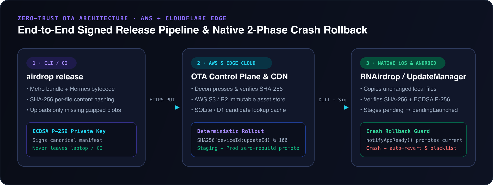
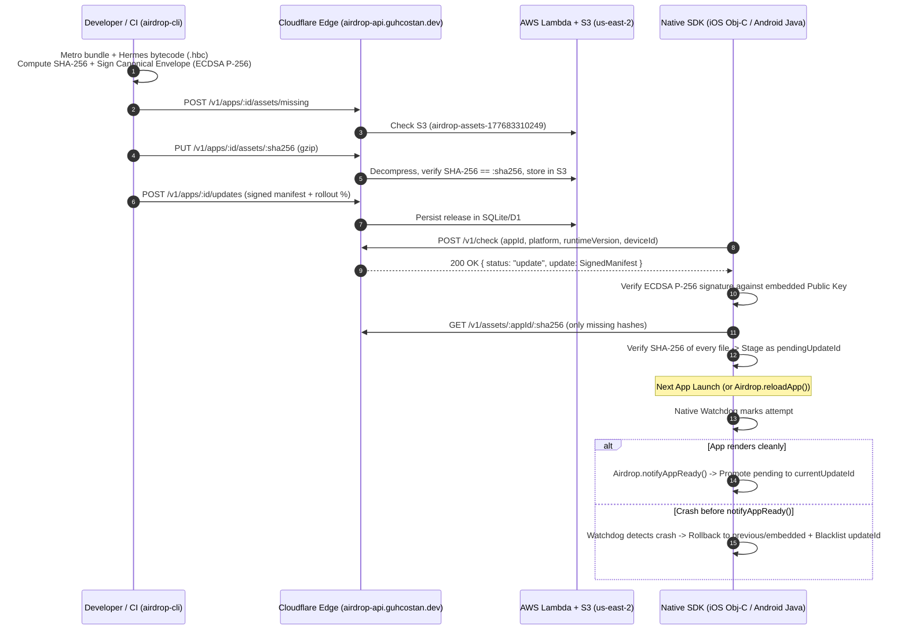

<div align="center">

<picture>
  <source media="(prefers-color-scheme: dark)" srcset="./brand/logo-wordmark-dark.png" />
  <source media="(prefers-color-scheme: light)" srcset="./brand/logo-wordmark-light.png" />
  
</picture>

<br />

# react-native-airdrop

**Zero-Trust Over-the-Air (OTA) Updates for React Native — Self-Hosted on AWS & Cloudflare Edge**

[](https://airdrop.guhcostan.dev)
[](https://airdrop-api.guhcostan.dev/health)
[](./e2e/prod-smoke.sh)
[](./LICENSE)

[**Live Website & Playground**](https://airdrop.guhcostan.dev) · [**Interactive Dashboard**](https://airdrop.guhcostan.dev/dashboard/) · [**Documentation**](https://airdrop.guhcostan.dev/docs/getting-started/) · [**Architecture & Security**](https://airdrop.guhcostan.dev/docs/security/) · [**Português (PT-BR)**](#-documentação-em-português-pt-br)

<br />


</div>

---

## Overview

**`react-native-airdrop`** is a complete, production-grade Over-the-Air (OTA) update platform for React Native (**0.71 → 0.87+**, New & Old Architecture, Hermes & JSC, Bare RN & Expo). Built after Microsoft retired App Center CodePush in March 2025, Airdrop eliminates per-MAU SaaS pricing and third-party vendor lock-in while enforcing hardware-grade cryptographic verification on every device.

```bash
# Compile Hermes bytecode, sign with ECDSA P-256, upload missing assets, and roll out to 20% of iOS devices:
airdrop release --platform ios --channel production --rollout 20 \
  --private-key ./airdrop-private-key.pem \
  --message "Hotfix checkout currency rounding"
```

### Live Production Endpoints

| Service | Custom Domain (Cloudflare DNS) | AWS Origin (`us-east-2`) | Purpose |
| :--- | :--- | :--- | :--- |
| **Landing Page, Playground & Docs** | [`https://airdrop.guhcostan.dev`](https://airdrop.guhcostan.dev) | [`https://d21al82u8wh9s4.cloudfront.net`](https://d21al82u8wh9s4.cloudfront.net) (`s3://airdrop-web-177683310249`) | Astro 5 + React 19 + shadcn/ui + Basecoat UI showcase, interactive OTA simulator & Starlight docs |
| **Release Console (Dashboard)** | [`https://airdrop.guhcostan.dev/dashboard/`](https://airdrop.guhcostan.dev/dashboard/) | `E386523JW8TUG2` (CloudFront OAC) | Manage apps, channels, rollout sliders, instant rollbacks, or launch the **Interactive Demo Sandbox** |
| **OTA Update & Admin API** | [`https://airdrop-api.guhcostan.dev`](https://airdrop-api.guhcostan.dev/health) | [`https://wyyzqc53772b4jdcamirdkh6yu0ydkit.lambda-url.us-east-2.on.aws`](https://wyyzqc53772b4jdcamirdkh6yu0ydkit.lambda-url.us-east-2.on.aws/health) (`s3://airdrop-assets-177683310249`) | Hono edge API proxied from Cloudflare DNS (`guhcostan.dev`) to AWS Lambda (`nodejs22.x` arm64) + S3 + SQLite/D1 |

---

## Why `react-native-airdrop`?

1. **Zero Per-MAU Tax & Full Infrastructure Ownership**
   Run on your own **AWS account** (S3 + CloudFront + Lambda Function URL) and/or **Cloudflare account** (Workers + D1 + R2). A 1,000,000 MAU fleet costs ~$5/month in raw cloud primitives instead of $400–$1,000+/month on managed OTA SaaS tiers.
2. **End-to-End ECDSA P-256 Code Signing**
   Your private key never leaves your developer machine or CI runner. The CLI signs a canonical manifest envelope (`airdrop-manifest-v1` covering `appId`, `channel`, `platform`, `runtimeVersion`, and every file's path + SHA-256). Native iOS (`SecKeyVerifySignature`) and Android (`java.security.Signature`) verify the signature against the public key baked into `Info.plist` / `strings.xml` before activating any bundle. Even a compromised server cannot ship malicious JS.
3. **2-Launch Crash Watchdog & Automatic Rollback**
   When an update is staged as `pending`, the native loader boots it on the next launch and increments a persistent launch counter before React Native initializes. If JS crashes before calling `Airdrop.notifyAppReady()`, the next launch automatically reverts to the previous known-good update (or embedded binary bundle) and blacklists the broken `updateId` in `failedUpdateIds`.
4. **Content-Addressed Deduplication**
   Every bundle and asset is stored and fetched by its uncompressed **SHA-256** digest. `POST /v1/apps/:appId/assets/missing` ensures the CLI only uploads files the server doesn't already have, and devices copy unchanged assets directly from their current installed release on disk.
5. **Deterministic Canary Rollouts (1–100%)**
   Staged rollouts use `SHA-256(deviceId + ":" + updateId) mod 100 < rolloutPercentage` — zero sticky-session state on the server, deterministic per device/update pair, and adjustable in real time via `airdrop rollout <updateId> <pct>`.

---

## Architecture & Security Model

<div align="center">
  
</div>

<br />

<div align="center">
  
</div>

### End-to-End OTA Lifecycle



---

## 2026 Competitor Benchmark

How `react-native-airdrop` compares against the post-CodePush React Native OTA ecosystem:

| Capability | `react-native-airdrop` | Expo EAS Update | RN Stallion | Revopush | Hot Updater | MS CodePush (Retired) |
| :--- | :---: | :---: | :---: | :---: | :---: | :---: |
| **License & Source** | **100% MIT Open Source** | Proprietary SaaS | Proprietary SaaS (SDK OSS) | Proprietary Fork | MIT Open Source | Retired (Mar 2025) |
| **Self-Host on AWS & Cloudflare** | **Yes (1 command)** | No | No | Partial (Docker) | Yes | No |
| **Bare React Native First-Class** | **Yes (0.71 → 0.87+)** | Requires `expo-updates` | Yes | Yes | Yes | Legacy only |
| **Expo Config Plugin** | **Included** | Included | Manual | Manual | Included | No |
| **End-to-End ECDSA P-256 Signing** | **Native (Zero-Config CLI)** | Paid Enterprise / Custom | Partial | RSA | Custom | CodePush Keys |
| **Automatic Native Crash Rollback** | **2-Launch Watchdog + Blacklist** | Best-Effort | Yes | Yes | Basic | Yes |
| **Content-Addressed Asset Dedup** | **SHA-256 per file** | Yes | Bundle-level | Zip-based | Bundle-level | Zip-based |
| **Zero-Egress Edge Caching** | **Cloudflare Edge + AWS S3** | AWS CloudFront (Metered) | Metered | Metered | Bring Your Own | Azure CDN |
| **Estimated Cost @ 500k MAU** | **~$5 / mo (Self-Hosted)** | ~$450+ / mo | ~$300+ / mo | ~$220+ / mo | ~$25+ / mo | Discontinued |

---

## Repository Structure

| Path | Package / Service | Description |
| :--- | :--- | :--- |
| [`packages/core`](./packages/core) | `@rn-airdrop/core` | Shared protocol types, SHA-256 rollout hashing (`isInRollout`), and canonical signing envelope (`signingMessage`) |
| [`packages/react-native`](./packages/react-native) | `react-native-airdrop` | React Native SDK — TypeScript client (`withAirdrop`, `useAirdrop`), Expo Config Plugin, iOS (`RNAirdrop.mm`) & Android (`Airdrop.java`) native modules |
| [`packages/cli`](./packages/cli) | `react-native-airdrop-cli` | Developer & CI CLI (`airdrop login`, `init`, `keygen`, `release`, `promote`, `rollout`, `rollback`, `updates`, `apps`, `tokens`) |
| [`apps/server`](./apps/server) | `@rn-airdrop/server` | Portable Hono OTA Server running on **AWS Lambda + S3 + SQLite** (`src/aws-lambda.ts`) and **Cloudflare Workers + D1 + R2** (`src/index.ts`) |
| [`apps/web`](./apps/web) | `@rn-airdrop/web` | Marketing Landing Page, Interactive React 19 + shadcn/ui + Basecoat UI Playground, Release Console (`/dashboard`), and Starlight Docs (`/docs`) |
| [`brand`](./brand) | Visual Identity | Vector logos (`logo.svg`, `logo-mono.svg`, wordmarks), OpenGraph card (`og.png`), architecture diagram (`architecture.svg`), and 3D visuals |
| [`examples/AirdropExample`](./examples/AirdropExample) | Example App | Real React Native 0.87 application wired to `react-native-airdrop` for automated E2E testing |
| [`e2e`](./e2e) | E2E Suites | `prod-smoke.sh` (real Hermes bundle + signed upload + edge download check), `local-e2e.sh` (JVM harness), and `device-e2e.sh` (Maestro iOS/Android) |
| [`scripts`](./scripts) | Automation | `deploy-aws.sh` (provisions S3 + CloudFront OAC + Lambda Function URL in `us-east-2`) & `build-brand.mjs` (renders brand PNGs via `sharp`) |

---

## Quick Start

### 1. Install the SDK & CLI

```bash
# In your React Native app:
npm install react-native-airdrop

# Install the CLI globally (or run via npx):
npm install -g react-native-airdrop-cli
```

### 2. Initialize Your App & Generate ECDSA P-256 Signing Keys

```bash
airdrop login --server https://airdrop-api.guhcostan.dev --token <YOUR_TOKEN>
airdrop init --name "My Production App" --sign
```

`airdrop init --sign` creates:
- `airdrop.config.json` (checked into git — contains `serverUrl`, `appId`, and the **public** key).
- `airdrop-private-key.pem` (gitignored — keep in your password manager and CI secrets as `AIRDROP_PRIVATE_KEY`).

### 3. Configure Native Projects (Expo or Bare React Native)

#### Option A: Expo (Prebuild / Config Plugin)

Add the plugin to `app.json` or `app.config.ts`:

```json
{
  "expo": {
    "name": "MyApp",
    "version": "1.4.0",
    "plugins": [
      [
        "react-native-airdrop/expo",
        {
          "serverUrl": "https://airdrop-api.guhcostan.dev",
          "appId": "00000000-0000-4000-8000-000000000000",
          "channel": "production",
          "publicKey": "-----BEGIN PUBLIC KEY-----\nMFkwEwYHKoZIzj0CAQYIKoZIzj0DAQcDQgAE...\n-----END PUBLIC KEY-----"
        }
      ]
    ]
  }
}
```

#### Option B: Bare React Native (iOS & Android)

**iOS (`ios/AppDelegate.swift`)**:

```swift
import ReactNativeAirdrop

override func bundleURL() -> URL? {
#if DEBUG
  RCTBundleURLProvider.sharedSettings().jsBundleURL(forBundleRoot: "index")
#else
  RNAirdrop.bundleURL()
#endif
}
```

**Android (`android/app/src/main/java/.../MainApplication.kt`)**:

```kotlin
import com.rnairdrop.Airdrop

override val reactHost: ReactHost by lazy {
  getDefaultReactHost(
    context = applicationContext,
    packageList = PackageList(this).packages,
    jsBundleFilePath = Airdrop.getJSBundleFile(applicationContext),
  )
}
```

### 4. Wrap Your Root Component (or Use the Hook)

```tsx
import { withAirdrop } from "react-native-airdrop";

export default withAirdrop(App, {
  checkOnMount: true,
  checkOnForeground: true,
  installMode: "ON_NEXT_RESTART", // or "IMMEDIATE" for mandatory updates
});
```

Or build a custom update banner with `useAirdrop()`:

```tsx
import { useAirdrop, Airdrop } from "react-native-airdrop";

export function UpdateBanner() {
  const { status, availableUpdate, isUpdatePending } = useAirdrop();

  if (!isUpdatePending) return null;
  return (
    <Pressable onPress={() => Airdrop.reloadApp()}>
      <Text>Update {availableUpdate?.id.slice(0, 8)} ready — Tap to restart</Text>
    </Pressable>
  );
}
```

### 5. Ship & Manage Releases

```bash
# Publish a signed update to 10% of production devices:
airdrop release --platform ios --channel production --rollout 10 \
  --private-key ./airdrop-private-key.pem \
  --message "Fix checkout button alignment"

# Inspect installs, downloads, and rollbacks:
airdrop updates list --channel production

# Expand rollout to 100%:
airdrop rollout <updateId> 100

# Promote a tested staging release to production (signature remains valid):
airdrop promote <updateId> --to production

# Instant server-side rollback if needed:
airdrop rollback <updateId>
```

---

## Self-Hosting & Deployment (AWS + Cloudflare)

### Deploy to AWS (`S3 + CloudFront + Lambda Function URL`)

The repository includes an automated, idempotent AWS provisioning & deployment script ([`scripts/deploy-aws.sh`](./scripts/deploy-aws.sh)) that deploys:
1. **S3 Bucket (`airdrop-web-<account-id>`) + CloudFront Distribution (`PriceClass_100`, Origin Access Control, URL rewrite function)** for `apps/web`.
2. **S3 Bucket (`airdrop-assets-<account-id>`) + AWS Lambda (`airdrop-api`, `nodejs22.x` arm64, `node:sqlite` + S3 snapshot sync + Function URL)** for `apps/server`.

```bash
export AWS_REGION=us-east-2
export AIRDROP_ADMIN_TOKEN="your-secret-admin-token"
bash scripts/deploy-aws.sh
```

### Deploy to Cloudflare (`Workers + D1 + R2` & Custom Domains `guhcostan.dev`)

```bash
# 1. Deploy the OTA API Worker (and connect to AWS Lambda origin or D1/R2):
cd apps/server
npx wrangler d1 migrations apply airdrop --remote
npx wrangler deploy

# 2. Build and deploy the Landing Page, Playground & Docs:
cd ../..
pnpm web:build
cd apps/web && npx wrangler deploy
```

---

## Development & Verification

```bash
# Install workspace dependencies:
pnpm install

# Run typecheck across all packages:
pnpm typecheck

# Run all 60 unit & integration tests (core, react-native SDK, CLI, server):
pnpm test

# Build all packages & static web app:
pnpm build
pnpm web:build

# Run the production E2E smoke test (Metro + Hermes + ECDSA signing + upload + download SHA-256 check):
AIRDROP_SERVER="https://airdrop-api.guhcostan.dev" \
AIRDROP_TOKEN="<ADMIN_TOKEN>" \
bash e2e/prod-smoke.sh
```

---

## 🇧🇷 Documentação em Português (PT-BR)

### Visão Geral

O **`react-native-airdrop`** é uma plataforma completa de atualizações Over-the-Air (OTA) para React Native (**0.71 a 0.87+**, Nova e Antiga Arquitetura, Hermes e JSC, Bare React Native e Expo). Criado para substituir o Microsoft CodePush com arquitetura moderna **Zero-Trust**, o Airdrop permite enviar correções de JavaScript e imagens diretamente aos dispositivos em segundos, sem depender da fila de revisão da App Store ou Google Play e sem pagar mensalidades por MAU (usuários ativos mensais).

### Infraestrutura em Produção (AWS + Cloudflare `guhcostan.dev`)

O projeto está implantado e operando em produção integrando **Cloudflare DNS (`guhcostan.dev`)** e **AWS (`us-east-2`)**:

- **Landing Page, Playground Interativo e Documentação**:
  - **URL Principal (Cloudflare DNS + Edge)**: [`https://airdrop.guhcostan.dev`](https://airdrop.guhcostan.dev)
  - **Console / Dashboard Interativo**: [`https://airdrop.guhcostan.dev/dashboard/`](https://airdrop.guhcostan.dev/dashboard/) (inclui modo *Interactive Demo Workspace* para testar rollouts, promoção de canais e rollbacks sem precisar de token)
  - **Origem AWS CloudFront + S3**: [`https://d21al82u8wh9s4.cloudfront.net`](https://d21al82u8wh9s4.cloudfront.net) (Distribuição `E386523JW8TUG2` conectada ao bucket `s3://airdrop-web-177683310249`)
- **API OTA & Servidor de Releases**:
  - **URL Principal (Cloudflare DNS + Edge Proxy para AWS)**: [`https://airdrop-api.guhcostan.dev`](https://airdrop-api.guhcostan.dev/health)
  - **Origem AWS Lambda Function URL (`us-east-2`)**: [`https://wyyzqc53772b4jdcamirdkh6yu0ydkit.lambda-url.us-east-2.on.aws`](https://wyyzqc53772b4jdcamirdkh6yu0ydkit.lambda-url.us-east-2.on.aws/health) (Lambda `airdrop-api` arm64 com persistência no bucket `s3://airdrop-assets-177683310249`)

### Diferenciais Técnicos

- **Assinatura Criptográfica Ponta a Ponta (ECDSA P-256)**: A chave privada fica apenas na sua máquina ou no GitHub Actions. O app nativo valida a assinatura com a chave pública embutida no binário antes de aplicar qualquer atualização.
- **Auto-Rollback Nativo contra Crashes**: Se uma atualização OTA causar crash na inicialização antes de `Airdrop.notifyAppReady()`, o watchdog nativo reverte automaticamente para a versão anterior funcional e adiciona o `updateId` defeituoso à lista de bloqueio local.
- **Deduplicação por SHA-256**: Cada arquivo é endereçado pelo seu hash SHA-256. Dispositivos baixam apenas os arquivos que mudaram entre releases.
- **Identidade Visual & Componentes**: Landing page construída com **Astro 5**, **React 19**, **shadcn/ui (Radix UI)** e **Basecoat UI**, contando com simulador OTA interativo em 4 abas, calculadora de custos por MAU e comparativo técnico completo contra concorrentes.

### Comandos Principais

```bash
# Rodar todos os testes unitários e validação de tipos:
pnpm typecheck && pnpm test

# Gerar os assets de marca (logos, OpenGraph, diagramas):
node scripts/build-brand.mjs

# Fazer deploy completo na AWS (S3 + CloudFront + Lambda em us-east-2):
bash scripts/deploy-aws.sh

# Testar o fluxo E2E completo em produção (Hermes real + assinatura ECDSA + upload + download):
AIRDROP_SERVER="https://airdrop-api.guhcostan.dev" AIRDROP_TOKEN="<TOKEN>" bash e2e/prod-smoke.sh
```

---

## License

Released under the [MIT License](./LICENSE).
